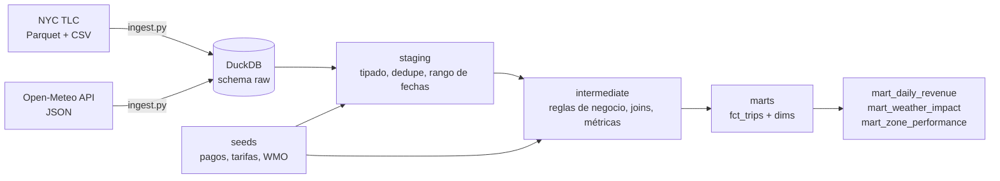

# 🚕 NYC Taxi & Weather — ELT con dbt + DuckDB


Pipeline **ELT end-to-end, 100% gratuito y local**: ingesta de datos reales (viajes de taxi de NYC + clima horario
desde una API), modelado dimensional con **dbt**, tests de calidad, CI en GitHub Actions y documentación autogenerada.

> **Pregunta de negocio:** ¿cómo evolucionan los ingresos diarios y cómo afecta el clima a la demanda de taxis?

## Arquitectura



## Fuentes de datos (reales, sin API key)

| Fuente | Tipo | Uso |
|---|---|---|
| [NYC TLC Yellow Taxi](https://www.nyc.gov/site/tlc/about/tlc-trip-record-data.page) | Parquet mensual | Hechos de viajes |
| TLC Taxi Zone Lookup | CSV | Dimensión de zonas |
| [Open-Meteo Historical Weather API](https://open-meteo.com/en/docs/historical-weather-api) | REST/JSON | Clima horario de NYC |

Podés reemplazar o sumar fuentes: sólo agregá la carga en `ingestion/ingest.py` y declarala en `models/staging/_sources.yml`.

## Quick start

Requisitos: Python 3.10+ y `make`.

```bash
git clone https://github.com/<TU_USUARIO>/<TU_REPO>.git && cd <TU_REPO>/01-dbt-duckdb-elt
make setup && source .venv/bin/activate

make run-sample                      # datos sintéticos, offline, ~10 segundos
# o con datos reales (descarga ~50 MB por mes):
make run START=2024-01 END=2024-03

make validate                        # conteos por capa y checks automáticos (ya incluido en make run)
make serve                           # abre la documentación y el linaje en http://localhost:8080
```

Para consultar el resultado: `duckdb data/warehouse.duckdb` y luego `select * from marts.mart_weather_impact;`

## Resultados y validación

Ejecutado con datos reales de **enero a marzo de 2024** (`make run START=2024-01 END=2024-03`):

| Capa | Filas | Comentario |
|---|---:|---|
| `raw.taxi_trips` | 9.554.778 | Coincide exactamente con la suma de los 3 archivos Parquet (2.964.624 + 3.007.526 + 3.582.628) |
| `staging.stg_taxi_trips` | 9.554.756 | −22 filas con fecha fuera del rango de análisis |
| `marts.fct_trips` | 9.177.360 | −3,95% por filtros de calidad (duración, distancia, tarifa y velocidad imposibles). **Se conserva el 96,05%** |

`make validate` (`ingestion/validate.py`) comprueba además: raw = suma por archivo, `raw ≥ staging ≥ fct`, ≥ 90% conservado,
**0 viajes sin clima** (2.184 horas = 91 días × 24), sin `trip_id` duplicados. Corre también en el CI.

**Plausibilidad:** tarifa promedio 18,67 USD · 3,3 millas · 15,6 min · 11,3 mph. Las zonas con más ingresos son
JFK, LaGuardia, Midtown Center, Times Sq/Theatre District y Upper East Side South.

### Cómo leer `mart_weather_impact` (limitaciones)

- **Correlación, no causalidad.** Los viajes por hora varían poco entre climas (≈ 3.700–4.450) y no debe leerse como "la lluvia no afecta
  la demanda": cada categoría mezcla horas del día, días de la semana y estacionalidad distintos. Un análisis causal requeriría
  controlar por franja horaria y tipo de día.
- **Propinas:** TLC sólo registra propinas con tarjeta; `avg_tip_pct` promedia todos los pagos, por lo que subestima la propina real de
  quienes pagan con tarjeta.
- **Outliers:** se conserva el rango plausible de tarifas; los montos extremos (hasta ~1.000 USD) se revisan con la consulta 8 de `validate.py`.

## Capas del proyecto

| Capa | Materialización | Responsabilidad |
|---|---|---|
| `raw` | tablas (carga Python) | Copia fiel de la fuente + `_loaded_at`, `_source_file` |
| `staging` | view | Casteo, renombrado, deduplicación y acotado de fechas |
| `intermediate` | view | Reglas de negocio, métricas (duración, velocidad, propina %), joins con clima y seeds |
| `marts` | table / incremental | Modelo dimensional (`fct_trips`, `dim_zones`, `dim_date`) y marts analíticos |

## Decisiones técnicas

- **DuckDB** como warehouse: cero costo y cero infraestructura. Al ser SQL estándar, el proyecto se migra a Snowflake/BigQuery/Databricks cambiando el adapter y el `profiles.yml`.
- **`fct_trips` incremental** (`delete+insert` por `trip_id`, ventana de reproceso de 1 día) para absorber datos tardíos sin duplicar.
- **Calidad en dos niveles:** filtros de reglas de negocio en `intermediate` (viajes imposibles: duración, velocidad, tarifas ≤ 0, fechas fuera de rango) y tests declarativos sobre las salidas.
- **`trips_per_hour`** en `mart_weather_impact`: normaliza por horas de cada categoría de clima; sin esto el clima despejado "ganaría" por tener más horas.
- **Seeds** para diccionarios chicos y versionados (pagos, tarifas, códigos WMO de clima).
- **CI con datos sintéticos:** determinista y sin depender de APIs externas.
- **Carpetas de ingesta por fuente** (`data/raw/real` y `data/raw/sample`): la descarga es idempotente y sin esto los archivos sintéticos se reutilizaban al pasar a datos reales.

## Tests incluidos (36 genéricos + 2 singulares)

`unique` / `not_null` en claves · `relationships` hechos → dimensiones · `accepted_values` · `dbt_utils.accepted_range` ·
test de **reconciliación** (suma del mart = suma de hechos) · test de **consistencia temporal** (dropoff > pickup).

## Estructura

```
01-dbt-duckdb-elt/
├── ingestion/ingest.py        # Extracción + carga (real o sample; carpetas separadas en data/raw/<fuente>)
├── ingestion/validate.py      # Conteos por capa, plausibilidad y checks automáticos
├── dbt_project/
│   ├── models/{staging,intermediate,marts}/
│   ├── seeds/  tests/  analyses/  macros/
│   ├── dbt_project.yml  profiles.yml  packages.yml
├── .github/workflows/ci.yml   # dbt build en cada PR
├── Makefile  requirements.txt
```

## Habilidades que demuestra

SQL analítico (CTEs, window functions, `qualify`) · modelado dimensional (grain, facts/dims) · dbt (sources, refs, seeds,
incremental, tests, macros, docs, analyses) · Python para ingesta de APIs/archivos (idempotente) · CI/CD · reproducibilidad.

## Próximos pasos (ideas para extender)

- [ ] Dashboard con [Evidence.dev](https://evidence.dev) o Metabase sobre los marts
- [ ] Orquestar con Airflow/Dagster (ver proyecto 02 del portfolio)
- [ ] Unit tests de dbt (`unit_tests:`) para las métricas derivadas
- [ ] Lint de SQL con `sqlfluff` en el CI
- [ ] Snapshot (SCD2) de `dim_zones`
- [ ] Migrar el target a BigQuery sandbox (gratis) usando `dbt-bigquery`
